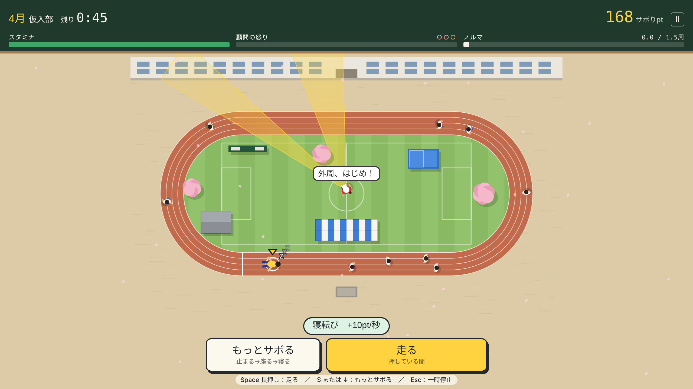

# 顧問が見てる

部活の外周ランニング。走るふりをしながら、顧問に怒られないようにどれだけサボれるかを競うブラウザゲームです。
4月の仮入部から2月の冬季練習まで、5回の練習で約7分。



## あそびかた

| 操作 | キーボード | タッチ・マウス |
| --- | --- | --- |
| 走る（押している間） | Space / → / D | 「走る」ボタン、またはグラウンドを長押し |
| もっとサボる | S / ↓ | 「もっとサボる」ボタン |
| 一時停止 | Esc / P | 右上のボタン |

- 「走る」を離すと歩きます。「もっとサボる」を押すたびに、立ち止まる → 座る → 寝転ぶ。
- 黄色い扇形が顧問の視界です。**テントや木、倉庫の陰には届きません**（視線は物に遮られます）。
- 視界の中でサボると怒りゲージがたまり、いっぱいになると怒られます。3回怒られるとその場で終了。
- 走り続けるとスタミナが切れてバテます（しばらく走れません）。どこかでサボる必要があります。
- 練習時間が終わるまでに、ノルマの周回を走り切ってください。

| サボり方 | 点／秒 | 走り出すまで |
| --- | --- | --- |
| ちんたら歩き | +1 | すぐ |
| 立ち止まり | +3 | 0.15秒 |
| 座り込み | +6 | 0.45秒 |
| 寝転び | +10 | 0.9秒 |

点が入るのは、見られていない間だけです。視線が届く直前に走り出すと「セーフ」で +5。

## 5回の練習

| 時期 | 内容 |
| --- | --- |
| 4月 仮入部 | 顧問はグラウンド中央から動かない。よそ見が多い |
| 6月 梅雨の晴れ間 | 顧問が歩いて場所を変える。陰になる場所も変わる |
| 8月 夏合宿 | スタミナの減りが早い。水飲み場で回復。顧問が双眼鏡で追ってくる |
| 10月 駅伝前 | 顧問が自転車で逆回りしてくる。ベルが鳴ったら振り返る |
| 2月 冬季練習 | 副顧問も見張る。テントは片付け済み。よそ見のフェイントあり |

得点はこの端末のランキング（上位10件）に残ります。月ごとに途中保存され、続きから遊べます。

## 動かす

依存ライブラリもビルドも不要です。画像・音声ファイルもありません（描画はCanvas、音はWebAudioで合成）。

```sh
npm start        # python3 -m http.server 8080 → http://localhost:8080
npm test         # ルールと視線判定のテスト（Node 20 以上）
node tools/bundle.mjs   # 任意：1ファイルにまとめた dist/komon-ga-miteru.html を作る
```

GitHub Pages で公開するには、リポジトリの Settings → Pages → Source を「GitHub Actions」にします。

## 構成

```
index.html / style.css   画面
src/geom.js              トラックの形、視線の遮蔽判定、視界の扇形
src/game.js              練習1回分のルール（顧問の行動、怒り、スタミナ、採点）。DOMに触れない
src/data.js              サボり方、物の配置、5回の練習の設定。調整はここ
src/render.js            Canvas描画
src/audio.js             効果音（笛、ベル、セミ、下校のチャイム）
src/main.js              入力、HUD、日誌ページ、保存
src/bot.js               自動操縦（タイトルのデモとテスト用）
test/game.test.mjs       テスト
```

テストでは、描かれる視界と実際の発見判定が一致すること、どの練習にも隠れ場所があること、
自動操縦が5回とも走り切れることなどを確認しています。

## License

MIT
